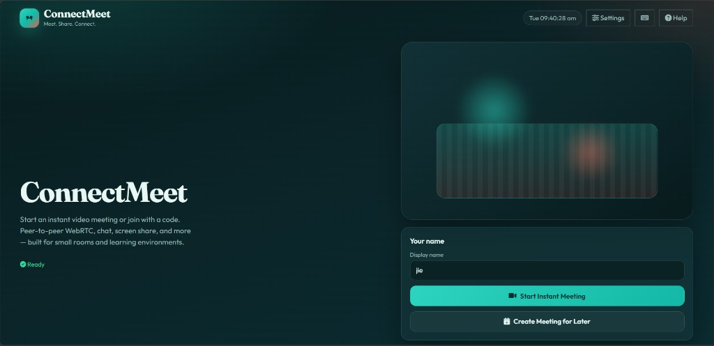
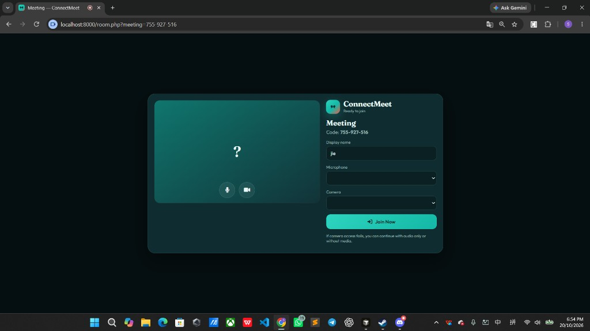
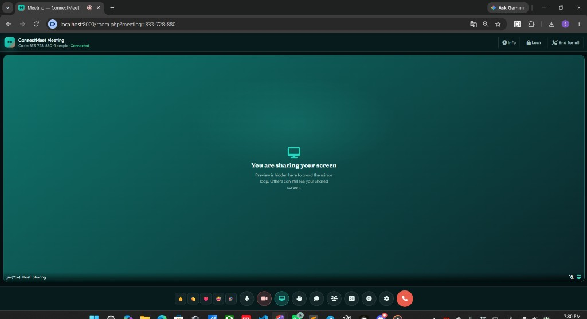

# ConnectMeet

ConnectMeet is a web-based video conferencing prototype inspired by the general flow of modern online meeting tools. It is an **independent** learning project — not affiliated with Google or any commercial meeting provider.

**Meet. Share. Connect.** — peer-to-peer WebRTC meetings with chat, screen share, and host controls, built for small rooms and learning environments.

## Screenshots

### Home — start or join a meeting



### Pre-join lobby — name, mic, and camera



### In-meeting — controls and screen share



## Features

- Instant meetings and “create for later” invitation links
- Unique meeting codes and shareable room URLs
- Pre-join lobby with camera/microphone preview and device selection
- Real WebRTC peer-to-peer audio/video (mesh topology)
- PHP JSON signaling (short polling): SDP offers/answers and ICE candidates
- Participant list, mute/camera sync, raise hand, emoji reactions
- In-meeting chat with server-side validation and XSS-safe rendering
- Screen sharing via `getDisplayMedia`
- Optional browser speech captions (local mic, Web Speech API where available)
- Optional local browser recording via MediaRecorder
- Host controls: lock meeting, remove participant, end for everyone
- CSRF protection, rate limits, hashed participant/host tokens, PDO prepared statements

## Stack

| Layer | Technology |
|-------|------------|
| Backend | PHP 8.3+ (8.4 tested) |
| Database | MySQL 8 / MariaDB, PDO |
| Frontend | HTML5, CSS3, vanilla JavaScript |
| Realtime media | WebRTC (`RTCPeerConnection`) |
| Signaling | PHP REST endpoints + short polling |

No Laravel, React, Vue, Node, or npm build step is required.

## Quick start (XAMPP / local Apache)

See **[INSTALLATION.md](INSTALLATION.md)** for full steps.

1. Place the project at `C:\xampp\htdocs\connectmeet\`
2. Import `database/install.sql`
3. Copy `config/config.example.php` → `config/config.php` and set DB credentials + `base_url`
4. Open `http://localhost/connectmeet/`
5. Start an instant meeting in one browser profile, join with the code in another

## Architecture (short)

```
Browser A  ←──WebRTC P2P──→  Browser B
    │                            │
    └── HTTP poll / POST ────────┘
              │
         Apache + PHP APIs
              │
            MySQL
```

- **Mesh:** each participant maintains peer connections to every other participant. Bandwidth and CPU grow roughly with `n×(n-1)`. Keep rooms small (default limit 8).
- **Signaling:** offers, answers, and ICE candidates are queued in `signaling_messages` and delivered by poll. Presence and chat use `meeting_events` / `meeting_messages`.
- **STUN** helps with many NATs. **TURN** is required for many corporate/symmetric NAT scenarios. Public STUN alone does not guarantee connectivity.
- **SFU** (Selective Forwarding Unit) is the usual upgrade path for larger meetings; it is **not** implemented in this PHP prototype.

## Security notes

- Never trust meeting codes, roles, or IDs from the browser alone — membership is checked with hashed participant tokens on every protected API call.
- Host actions require `role = host` on the authenticated participant row.
- Chat content is stored as plain text and escaped on display.
- Do not commit `config/config.php`. Production must use HTTPS and secure session cookies.

## Documentation

| Document | Contents |
|----------|----------|
| [INSTALLATION.md](INSTALLATION.md) | XAMPP, cPanel, STUN/TURN, troubleshooting |
| [TESTING.md](TESTING.md) | Test checklist and results |
| [ARCHITECTURE.md](ARCHITECTURE.md) | Deeper design and known limitations |

## License

Educational / prototype use. Review third-party CDN licenses (Font Awesome, Google Fonts) for your deployment.
